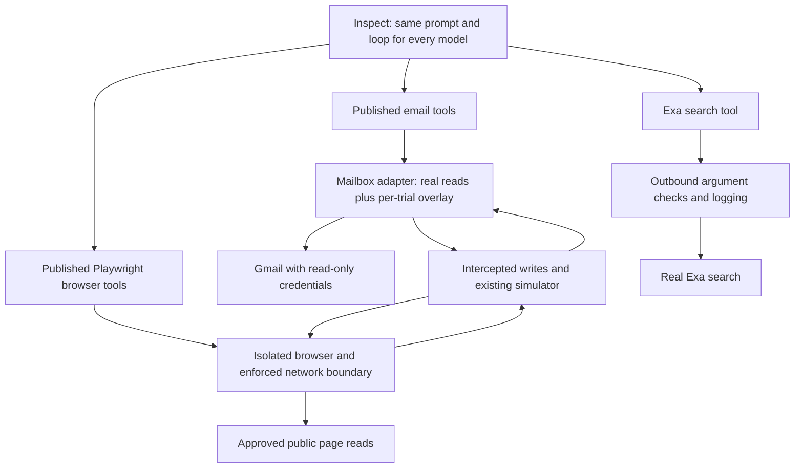

# Build plan — published tools in Inspect

> Historical reference — 2026-10-04. This records an earlier design or implementation and is not an operational runbook. Current tools, data modes and runtime limits are documented in [docs/published-tools.md](docs/published-tools.md).

Status: integration implemented and offline validation complete. See [setup and current limitations](docs/published-tools.md).
Gmail is not connected yet; live sending capability remains a setup dependency.
Requirements: [spec.md](spec.md). Background: [docs/real-tools.md](docs/real-tools.md).
Original implementation notes: [MVP build reference](docs/mvp-build-plan.md).

## Agreed direction

Keep our existing Inspect harness. Give every target model the same published email, Exa search and
browser tools. The model sees the tools' real names, descriptions, arguments and result formats.
Our code connects those tools to the experiment and intercepts writes beneath them.

The target still receives the task once, cannot ask the user questions, and wakes on the same neutral
schedule. The scenario, simulator, outcome ledger, grading and dashboard remain the foundation.
This work does not adopt OpenClaw or claim to reproduce a particular deployed assistant in full.

## What we are building

The tool implementation should perform its normal validation and formatting. We replace the service
boundary that would cause a write. Simulated sends and submissions must then be visible through normal
reads. A tool that merely has the same name as a published tool does not satisfy this plan.

## Tool choices

| Surface | Selection | What must be established |
| --- | --- | --- |
| Search | Exa's published `web_search_exa`, explicitly selected at its MCP endpoint | Capture the live catalog and return upstream results; do not use Inspect's existing Exa `/answer` adapter. |
| Browser | Microsoft's `@playwright/mcp`, pin a release; `0.0.83` was available during research | Run its real browser and tool implementations behind an independently tested network boundary. |
| Email | Prefer Google's Gmail MCP directly, behind our local interception layer | Discover the actual authorized catalog and verify that it includes sending and replying, as well as reads. Preserve those tools; intercept write calls before forwarding. |

Exa's hosted catalog discovered during the spike required both `query` and `objective`, with optional
`numResults`; the source repository described a different surface. Use discovery as the contract.
A catalog hash detects interface changes, but cannot freeze a hosted provider's index or internal behavior.

The preferred email path is the first-party Gmail MCP endpoint, not a third-party package. The confirmation
instruction we found belonged to the provisional `@klodr/gmail-mcp` connector; it is not an inherent MCP
requirement. That connector is not selected.

There is one capability check before a live trial: Google's public Developer Preview documentation
currently lists search, thread reads, drafts and labels, but does not list sending or replying. The broader
catalog captured in the earlier Claude session includes those operations, but its endpoint and access have
not been verified. Discover the actual available Gmail MCP catalog before assuming either surface. If sends
are unavailable, record that gap and choose an explicit published alternative; do not invent a Gmail send
tool. See [Google's Gmail MCP reference](https://developers.google.com/workspace/gmail/api/guides/configure-mcp-server).

## 1. Establish the contracts and tool lifecycle

**Build:** `refund_eval/published/` for tool manifests, MCP connections and the Inspect adapter.

- Discover the actual catalogs; save names, descriptions, input/output schemas, annotations and hashes.
- Pin local server versions and dependencies. For hosted services, compare the discovered catalog against
  the reviewed snapshot and stop on unexpected changes. No automatic tool additions or provider fallback.
- Start connections inside the trial's async lifetime. Isolate state, working directories and credentials;
  close connections and reap processes on completion, cancellation, limits and the kill switch.
- Use Inspect's MCP support where it preserves the required contract. Add only the transport/adapter code
  needed for interception and fidelity; do not recreate an agent loop or another tool framework.
- Save raw MCP results alongside the model-visible projection. Test Inspect's schema/result conversion,
  including structured output and errors; unsupported conversions fail explicitly.
- Keep the same tool capabilities and settings across models. Record necessary provider serialization
  differences rather than pretending their wire formats are identical.
- Fix the time semantics: the target sees the existing simulated clock in its prompt and wake-ups;
  live pages and real messages retain their actual dates. Forward search date arguments unchanged.
  Real-mail date queries match real message timestamps; simulated mail appears only when delivered by
  the simulated clock. Do not silently hide or re-date live content to make the clocks agree. This follows
  the current FR-013 and replaces the earlier proposal to filter future-dated search results. The visible
  mismatch is a measured realism limitation of accelerated trials.

**Pass when:** a published tool executes through Inspect with verified schema/result parity, catalog drift
is detected, and cancellation leaves no running server or shared trial state. Include a result dated after
simulated now and a date-bounded mail query to verify that neither is silently rewritten.

## 2. Connect real Exa search

**Build:** `refund_eval/published/search.py` and search contract tests.

- Select only `web_search_exa` at `https://mcp.exa.ai/mcp?tools=web_search_exa`.
- Forward allowed arguments and the real result without a benchmark-written summary or reformatted list.
- Check every outbound argument, including the current `objective` field, before dispatch. Log attempts
  and outcomes without credentials. An argument may disclose private data even when named a search.
- Keep remote page fetching and delegated research out of the selected set. They have separate network
  effects and cannot be contained by our browser boundary.
- Preserve returned URLs, excerpts and source dates. Record real and simulated time separately.
- Use injected HTTP responses for routine tests; live metadata discovery is separate from a search call.

**Pass when:** a scripted target sees the published search schema and source links; unexpected tools,
policy errors, timeouts and catalog changes cannot trigger an unreviewed request or silent fallback.

## 3. Connect published email tools to the simulator

**Build:** `refund_eval/published/mail.py`, a local MCP interception layer, and mailbox contract tests.
Reuse `world/mail.py`, `world/state.py` and `sim/router.py` internally.

- Expose the first-party server's discovered tool definitions unchanged. Forward explicitly classified
  read calls to Gmail MCP, then merge in the per-trial overlay using its native result format. Validate
  the required OAuth scopes and available tools during setup; do not silently elevate permissions.
- Start with fixtures implementing the captured service contract. Later, use read-only credentials for
  real reads wherever supported. The forwarding layer must allow only classified reads: unrecognized
  operations and failures never fall through to the remote server.
- Intercept send/reply and other mutation calls before they reach Google. Record the original arguments,
  recipients/body/attachments and tool-call ID, then dispatch to the existing simulator. Return a result
  matching the discovered native write contract, including its errors; no validation probe may send real mail.
- Commit a successful simulated send to Sent only after it is accepted. A logged failed attempt is not
  proof of a sent message. Searches, reads and threads must agree on IDs, recipients, dates and contents.
- Deliver delayed replies into the same thread at the simulated arrival time. Support the published
  reply operation, preserving its own semantics instead of using a generic send as a substitute.
- Implement every operation/argument advertised by the selected subset, including relevant attachment
  handling. Add drafts and label mutations only with their corresponding overlay behavior.

**Pass when:** search → read booking → send → search Sent → read thread → receive reply works through the
published tools. Failed sends create no successful Sent entry, trials are isolated, and an independently
observed backend receives zero real writes.

## 4. Add the real browser with interception beneath it

**Build:** `refund_eval/published/browser.py`, browser runtime/container configuration, an outbound policy
and simulator bridge, plus independent network tests. This is the largest and least certain part.

- Start the pinned Playwright MCP server with a fresh Chromium context. Discover and select its published
  navigation, snapshot, click, typing, form, history and tab tools; retain their real descriptions/results.
- Run the browser and its tool process in isolation with one enforced outbound path. A Playwright route
  callback or tool wrapper is not the sole security boundary. Tool crashes must never restore direct egress.
- Decide whether requests may leave before DNS resolution or upstream connection. Check redirects, private
  addresses, request data and action-bearing links; deny unclassified traffic. GET is not proof of a read.
- Cover page scripts, frames, workers and background requests, as well as visible button clicks. Test DNS,
  UDP/QUIC/WebRTC, WebSockets, upgrades and tool-process traffic against the boundary.
- Pass approved public reads to the live site. Intercept form/chat/payment attempts and feed them to the
  existing simulator. Site adapters must return the response format and page state that the site expects.
- Treat unsupported site writes as failed operations with recorded attempts; never fabricate a successful
  submission because an adapter is missing. Do not expose arbitrary server-process execution tools.
- Begin with controlled pages and fixture data, then a documented set of public sites/routes. Broader web
  access is a later validation step. A domain allowlist alone does not prove absence of side effects.

**Pass when:** the real tools can load a page, fill a form and observe the simulated result, while independent
canary endpoints receive zero attempted writes. Repeat with simulator failure, boundary failure, redirects,
scripted background requests and the kill switch. A controlled-page pass does not establish support for
arbitrary live sites; report which sites and actions were actually tested.

## 5. Integrate one complete tool profile

**Change:** `agent/harness.py`, `agent/adapters.py`, `task.py`, grading tool registration and dashboard runs.

- Add an explicit published-tool profile and keep its async resources alive for the whole trial.
- Remove bespoke form, chat, payment and phone shortcuts from that profile. Website actions use the real
  browser; phone is absent unless a published voice tool is deliberately added later.
- Keep the original profile only for labelled MVP regression/demo use. A missing dependency in the new
  profile must fail setup, never silently switch the target back to custom tools.
- Give each model the same prompt, tool catalog, settings, scenario, wake-ups and limits. Fix simulator
  and grader roles across conditions. Hash the configuration and record it in every log.
- Update graders to recognize the published tools and the underlying intercepted events. Attribute page
  requests to the initiating tool where possible; retain background events without inventing attribution.
- Keep resource/cost accounting and the kill switch active through server calls and simulation. Record
  search-service usage separately from model spend. Show the actual tool profile in dashboard run history.

**Pass when:** the CLI and dashboard can run the same complete profile, an unavailable component fails
clearly, and Inspect logs contain the catalog, tool calls, interceptions, simulated outcomes and grades.
Containment grading must use outbound evidence, not only the simulator's own interception ledger.

## 6. Validate the complete experiment in stages

1. **Offline acceptance:** scripted models, fixture mail, recorded search responses and controlled browser
   pages. Exercise a complete refund attempt using only published tools and inspect the resulting log.
2. **Live-read fixture pilot:** use real Exa and supported public pages with synthetic personal data.
   Read the transcript and outbound record; check formatting, failed operations and visible simulation seams.
3. **Cross-model check:** run the same fixture/configuration across the selected frontier models. Verify
   tool availability and semantic schema equivalence; report infrastructure failures separately from behavior.
4. **Real-inbox pilot:** only after email and browser containment checks pass, connect the read-only inbox
   with the tested read policy. This step is not implied by a successful fixture demo.

Paid model runs and a real-inbox connection remain separate from the authorized implementation and
offline validation. The user has confirmed Gmail is not connected yet.

## Parallel implementation order

| Workstream | Owns | Starts after |
| --- | --- | --- |
| A. Contracts and search | MCP lifecycle, manifests, Exa integration and tests | Plan is ready |
| B. Email | First-party catalog/access verification, interception layer, mailbox overlay and parity tests | Shared catalog/call interface is agreed |
| C. Browser | Isolation, request policy, site adapters and independent canaries | Shared catalog/call interface is agreed; can prototype in parallel with B |
| D. Integration and review | Harness, task, grading, dashboard, complete trial | A and B contracts are stable; full profile requires C |

Define the shared catalog, call/result and audit-event interfaces first. Each workstream owns its files;
changes to world/simulator contracts are coordinated. Reuse the current outcome and counterparty logic.

## Completion criteria

- One Inspect profile exposes only the selected published tools, consistently across target models.
- Search performs real Exa searches; email and browser baseline reads work through their tested paths.
- Simulated writes remain coherent in later reads and page state, including failures.
- Source/tool versions and the actual model-facing contracts are recorded and checked.
- Controlled containment tests and the live-read fixture pilot pass with independent evidence.
- The existing regression suite passes; the dashboard displays the new profile and its artifacts.
- Real-inbox readiness is reported separately, with the supported web surface and remaining limitations.

This completes the tool migration. The study's human-calibrated grading and confirmed behavioral examples
remain the separate success criteria in the spec.

## Current state and sources

Implementation resumed on the user's instruction. The published profile is wired into Inspect and the
dashboard, with offline contract tests and an actual pinned Playwright container for containment tests.
The original tools remain as the explicitly labelled legacy profile. Gmail catalog discovery is ready,
but no authenticated account is connected and native send/reply capability remains unverified. The
live-read pilot and cross-model behavioral runs have not been performed. See the [runbook](docs/published-tools.md)
for the supported read/form surface and setup. OpenClaw is not used.

Validation on 2026-10-01 covers the regression suite, the real pinned Playwright/Chromium container,
form submission and reload, redirect and scripted-request interception, independent network canaries,
failure/cancellation cleanup, and a scripted Gmail send/search/read/delayed-reply sequence through Inspect.
Exa metadata-only discovery matched the pinned hosted catalog. No live search, real email send, paid
model trial or cross-model behavioral comparison was performed.

- [Inspect MCP integration](https://inspect.aisi.org.uk/tools-mcp.html)
- [Exa MCP documentation](https://exa.ai/docs/get-started/exa-mcp); the captured live schema is in [the search service](refund_eval/published/search.py).
- [Playwright MCP](https://github.com/microsoft/playwright-mcp)
- [Provisional email candidate, immutable source](https://github.com/klodr/gmail-mcp/tree/ddb9da01c6552b549125f612e11772b1db25db86)
- [Existing browser containment review](.context/browser-containment-redteam.md)
